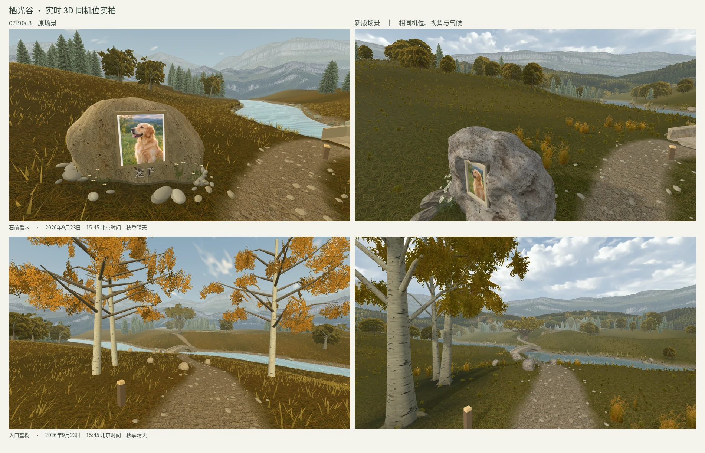
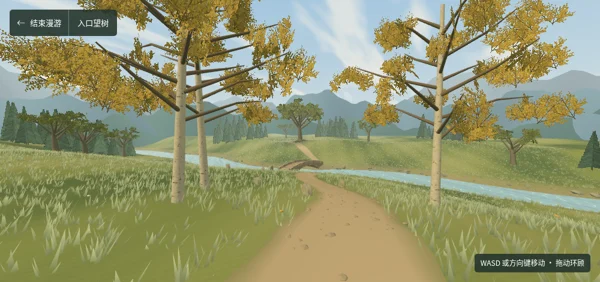
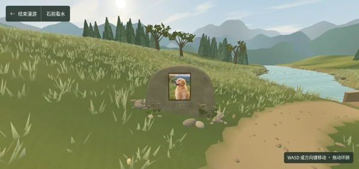
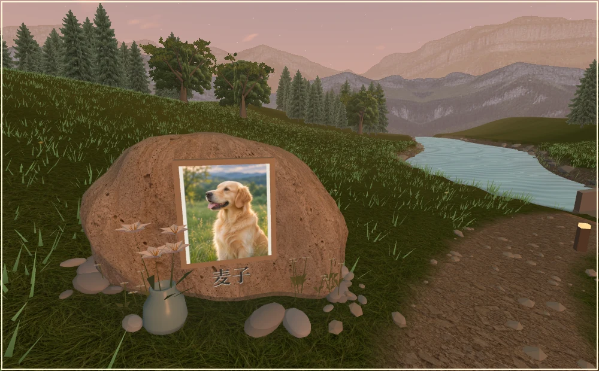
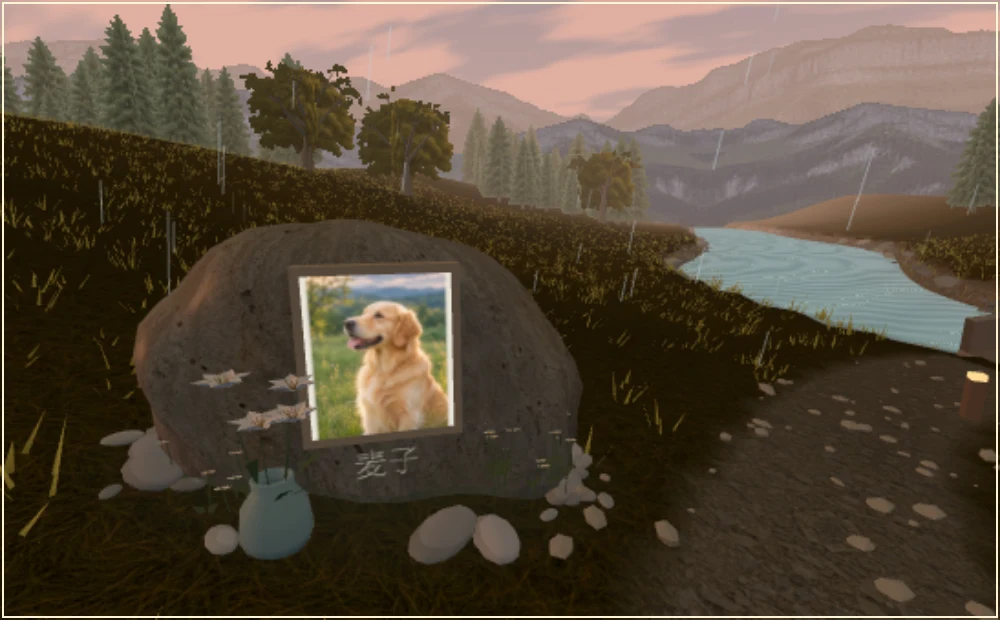
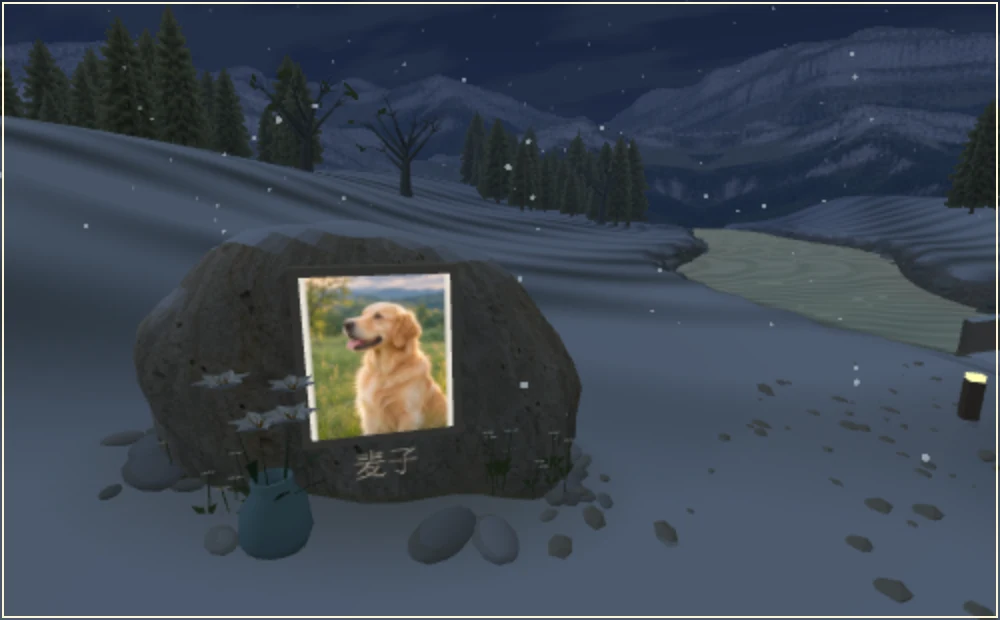
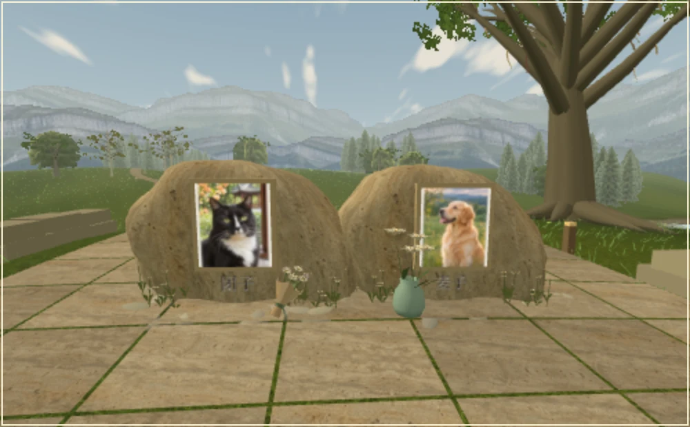

# 河湾样板 · 浏览器验收

## 游园流畅度 · 2026-11-19

基线为 `20ce78e`。在同一版本的 Chromium 156 和 SwiftShader 软件渲染器中，以 1280 × 720、DPR 1、相同秋季晴天进行前后对照。从入口真正按下 W，沿相同方向行走 22.8 米。基准按 250 毫秒逻辑步长给出同样的 24 个位置，每帧回读一个像素后再用实际耗时计算绘制速度。自动档在这个基准中收到相同的慢帧序列。精细档全程使用相同的内部分辨率。

| 画质 | 基线实际绘帧 | 新版实际绘帧 | 内部画幅 |
| --- | ---: | ---: | --- |
| 精细 | 1.59 帧/秒 | 1.70 帧/秒 | 两版均为 1280 × 720 |
| 轻量 | 2.27 帧/秒 | 5.16 帧/秒 | 基线 1024 × 576，新版 705 × 396 |
| 自动，同一段慢速输入 | 2.07 帧/秒 | 6.86 帧/秒 | 基线从 1280 × 720 逐步降至 832 × 468，新版在预热后以 537 × 302 走完全段 |

用真实动画回调时间按住 W 约 12 秒，再用同步像素回读逐帧计时。基线 12.31 秒画完 21 帧，平均 1.71 帧/秒；新版 12.10 秒画完 63 帧，平均 5.21 帧/秒。单帧耗时的第 95 百分位由 770 毫秒降至 396 毫秒。由于两次运行的实际时间步长不同，最终位置也不同；上表则固定了路线的每个测点。

软件渲染下的步行仍能感到卡顿。四个固定机位还分别拍了下午与落日，共八对真实画面。石前的宠物照片与桥、树下的河湾、庭院长椅均可辨认。各机位的提升不均匀；例如精细档在入口驻足时从 1.48 变为 1.44 帧/秒。此轮没有硬件 GPU 或手机真机测量。[四机位对照，左为基线，右为新版](docs/scene-riverbend/prototype/performance/fixed-views.webp)

自动模式另验证了停步看照片。固定气候与动画相位，先在石前取一张全分辨率画面，行走降档，再回到同一位置。1280 × 720 恢复后的全帧 RGBA 哈希与出发前一致。启用「减少动态效果」后，连续半秒的 30 次静止回调由 30 次重绘降至 0 次。第一次按 W 时随即提交画面与位移。静止期间仍会定期更新园区天色。

复测需要两个独立的已安装依赖的检出目录，以及 Python Playwright / Chromium。以下命令复测精细档。可将两条命令的 `fine` 同时换成 `low` 或 `auto`。使用 `--idle-only` 检查驻足后首次按键，`--restore-only` 核对完整像素。

```sh
python3 scripts/capture-scenes.py --site /tmp/pets-before --measure-only --quality fine --out /tmp/fine-before
python3 scripts/capture-scenes.py --site . --measure-only --quality fine --compare /tmp/fine-before/capture.json --out /tmp/fine-after
python3 scripts/capture-scenes.py --site . --natural-only --quality auto --out /tmp/auto-natural
```

## 河湾实景美术修订 · 2026-11-19

左列来自上一版 `07f90c3`，右列来自本次修订。两列均由 Chromium 156 实际运行 Three.js 漫游模块后截图。相机位置、朝向、65° 垂直视角与 1280 × 720 渲染尺寸相同，园区时钟固定在北京时间 9 月 23 日 15:45，秋季晴天。石前可以比较岩面、桥与近岸水色，入口可以比较白桦、林缘与远山之间的层次。



新版的正式落脚点另行实拍。桌面从石前能同时看见照片、桥拱和许愿树。树下回望时，布带位于近处枝条，桥位于远处河面。在 390 × 740 手机视口，从庭院落脚点可同时看清两只示例宠物的照片和花束。[石前全幅](docs/scene-riverbend/prototype/revision/stone.webp) · [树下回望](docs/scene-riverbend/prototype/revision/oak.webp) · [手机家庭庭院](docs/scene-riverbend/prototype/revision/family-mobile.webp)

交付的独立 HTML 在断网 Chromium 中完成桌面步行和 390 × 844 触屏模拟。两端均能切换四个机位和三种气候组合，退出后可阅读纪念册。两端各记录到零条外部 HTTP 请求、控制台错误和未捕获异常。桌面轻量画布为 928 × 405，驻足自动和精细均为 1160 × 507；竖屏对应 312 × 459 与 390 × 574。浏览器的文件导航受到限制，测试通过本地文件选择器读入交付文件，再用 Blob 打开。360 × 740 禁用 WebGL 的模拟环境下仍能看四幅导览、打开纪念册并切换两个光照预设。

独立性能采样使用 Chromium 156 的 SwiftShader 软件渲染，1280 × 720 视口，按完整绘制结束计帧。庭院驻足时以全分辨率绘制 18 帧，用时 20.38 秒，约 0.88 帧/秒。入口持续步行预热后，自动画质降到 832 × 468，24 帧用时 10.28 秒，约 2.33 帧/秒。软件渲染下步行有明显卡顿。带硬件加速的电脑、iOS 和 Android 真机帧率尚待测量。

复拍时在两个版本各自完成 `npm ci`，另安装 Python Playwright 和 Chromium。第一遍把旧版的位置保存为 `rig.json`，第二遍将它用于新版。省略 `--rig` 可拍摄对应版本的正式落脚点。脚本另存相机参数、浏览器、渲染器、时刻和控制台错误。

```sh
python3 scripts/capture-scenes.py --site /tmp/pets-old --out /tmp/river-before
python3 scripts/capture-scenes.py --site . --rig /tmp/river-before/rig.json --out /tmp/river-after
```

## 首版视觉参考与浏览器记录

2026-11-19 · 本轮验收范围为概念图导览、可通行地形、地点直达与只读纪念册。首屏以「石前看水」为视觉参考。将原图与浏览器截图并排核对，再用模拟手机检查裁切。概念图中的相框和雏菊在两种界面上均可辨认；桌面操作位于相框右侧，手机操作位于画面下方。

[原始参考](docs/scene-riverbend/stone.webp) · [桌面首屏](docs/scene-riverbend/prototype/desktop.webp) · [手机首屏](docs/scene-riverbend/prototype/mobile.webp)

## 实时漫游的复查

首次实现中，相框横向裁切了宠物照片，入口也缺少指路的白桦。调整为 4:5 竖幅并在入口补上三株白桦。以下为修改后的实际 WebGL 场景截图。地形现可用于确认步行路线和视角；石材、植被密度和日照仍需后续美术迭代。

| 入口望向桥与树 | 站在纪念石前 |
| --- | --- |
|  |  |

生产构建在 Chromium 156 / SwiftShader 以本地连接进行单次采样。「首屏」记录从导航到漫游按钮可操作，「进入」记录从点击到 WebGL 画布可用。「漫游」取自适应分辨率稳定后约 4.5 秒移动操作中的动画帧回调频率。

| 环境 | 首屏 | 进入 | 漫游 | 实际操作结果 |
| --- | ---: | ---: | ---: | --- |
| 桌面 1366 × 768，DPR 1 | 641 ms | 2396 ms | 7.5 帧/秒 | 键盘位移、切换三机位、Esc 退出、打开地图与纪念册均通过 |
| 手机模拟 390 × 844，DPR 2 | 303 ms | 2447 ms | 10.8 帧/秒 | 触屏按住方向键产生位移，三个落脚点可直达，退出后仍可看相册，页面无水平溢出 |
| 禁用 WebGL | 648 ms | — | — | 显示可理解的提示，无残留画布，取景、地图与纪念册可用 |

两组正常会话均无未捕获异常或控制台报错。软件渲染下的帧率偏低，加入根据持续慢帧调低内部渲染分辨率的处理；真机硬件、移动网络、Safari 及较长时间的流畅度仍待检查。以上测量属于云端样板验收。

final result: passed

## 纪念体验 · 2026-11-19

使用临时 SQLite 数据库、虚构的猫咪「晚栗」和三个独立浏览器会话，覆盖园主、手机模拟访客及新设备恢复。31 条浏览器断言通过。以下是同一次探访的两种视图。

[手机访客献花的纪念页](docs/memorial/visitor.webp) · [桦坡石前的照片与花束](docs/memorial/garden-3d.webp)

| 操作 | 实际结果 |
| --- | --- |
| 上传测试猫照、选桦坡、私下预览并保存 | 园主能看见；访客的档案与照片请求均返回 404 |
| 公开花园、复制链接、访客探访 | 两个入口返回 200。公开目录出现该花园，轻量页能看到原本上传的猫 |
| 关闭及重新开放收花，访客送一束雏菊 | 收花设置生效；花计数在两个独立会话一致，WebGL 石前显示照片与赠花 |
| 再次转私密，在另一设备会话用恢复码回访 | 访客原链接与图片均返回 404；主人恢复后仍能看见照片与花，获得新恢复码 |

实际手机、外部网络、支付与长期归档未在本轮测试中覆盖。

## 开放园区与四季 · 2026-11-19

在真实 WebGL 场景的同一石前机位，用虚构档案切换时段、季节与天气。春晨可辨认草坡、相框和桥边近水，秋季雨后石面变暗，冬夜雪覆盖岸坡、河心仍显水色。东岸庭院使用经过园主授权的家庭成员数据。下列四张是生产渲染模块的实拍。

| 春晨 · 河湾 | 秋日暮雨 · 河湾 |
| --- | --- |
|  |  |
| **冬季雪夜 · 河湾** | **听风山庭 · 两位家庭伙伴** |
|  |  |

- **园主与探访者**　40 条浏览器断言通过。独立会话覆盖待付订单恢复、照片预览、公开分享、匿名花束与礼物、庭院、寄语撤回、跨设备恢复和离线导出。另有 6 项触屏模拟检查覆盖四处地标、同机位天气变化、页面宽度与异常。
- **沿路发现纪念地**　使用七份虚构的公开档案。第一片六座，第二片一座。桌面从入口按 W 可走到第六处附近；鼠标点第三座石碑准确打开第三只宠物。手机模拟选择第二座直达，按近身探访后匿名送花写入同一数据库。主人撤回后，再点原碑无法读取档案。[手机步道探访截图](docs/scene-riverbend/prototype/world/public-walk.webp)
- **档案**　离线 Chromium 上下文成功读取 HTML、展示照片并导出原始 JPEG。原件与上传文件的字节及 SHA-256 一致，渲染记录到 0 个 HTTP 依赖。另从整库快照恢复到空目录，核对私密状态、档案及赠礼数据。独立的场景逻辑与付款签名、重试和恢复也有 Node 回归测试。
- **性能范围**　三次反复创建与释放双宠场景后，几何体、纹理与场景子项都回到预热基线。在 500 × 310 的独立压力探针，云端 SwiftShader 软件渲染约 2.9–5.4 帧/秒。该环境能验证取景和交互，移动真机、Safari 和目标机型的长时流畅度仍待实测。图片导览可以直接使用。
