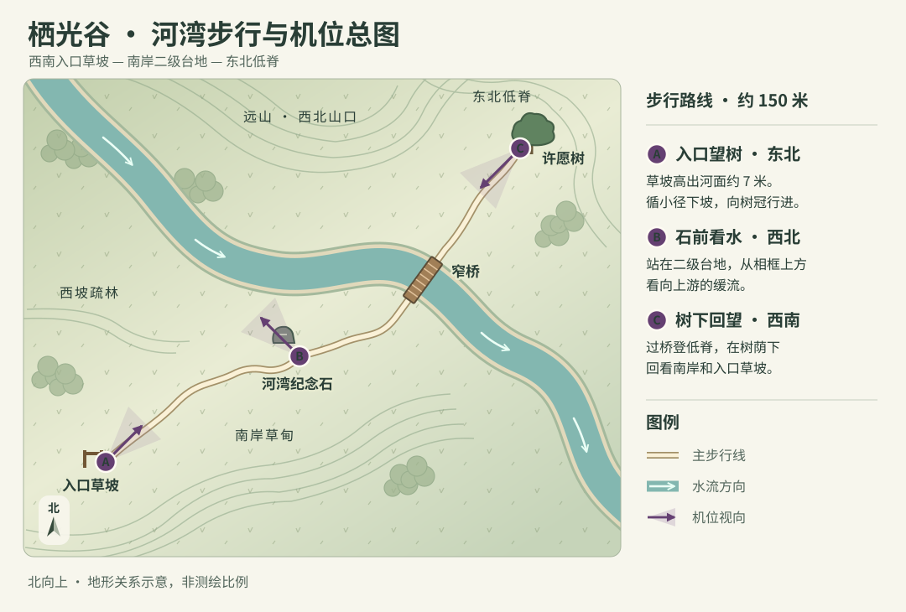
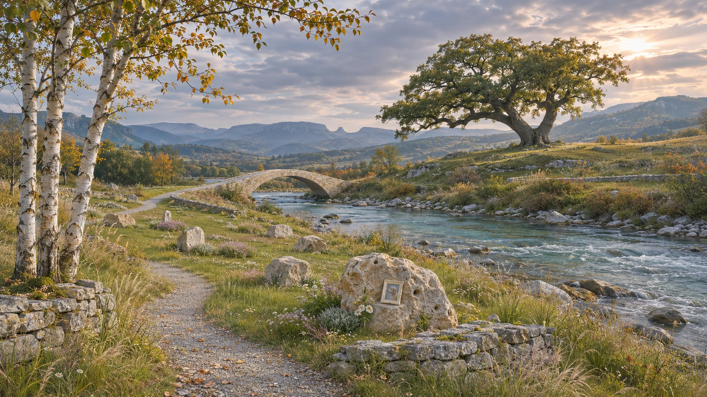
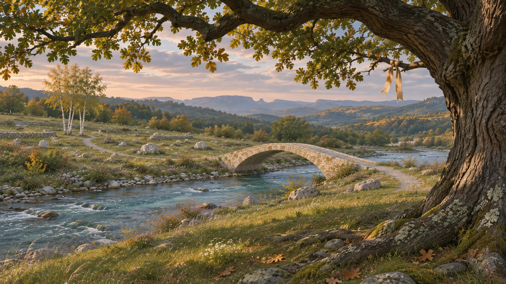

# 河湾 · 风景样板

栖光谷的第一段步行路线从西南桦坡出发，沿南岸经过一块纪念石，再过桥走到东北低脊的许愿树下。三幅概念图共用初秋傍晚的光色、单拱石桥、白桦和浅色石灰岩，可按步行顺序查看。

## A　入口望树

站在入口先找树冠，再找过河的桥。前景几块纪念石有真实石块的高低与间距，主路从它们身侧经过。搭地形时需保留草坡与河面的约 7 米高差，让初访者能一眼看清路线。

## B　石前看水

走近后，照片成为画面里最清楚的东西。相框下面留出能放一小束花的石沿，河声和水面留在身后。作为后续材质与比例的首选参考，先调好石头、相框和一朵免费花之间的大小关系，再加周围草木。手机竖屏应重新取景，使照片、花束和一小段河面同时可见。

## C　树下回望

视线从近处布带移到桥面，最后停在对岸的桦树。这是来路的反向视角，树下可以安静停留。后续制作时让风先动枝梢，再带起布带的末端，保留无遮挡的回望视线。

## 搭建交接

总图确定地标位置、河流走向与相机方位。三幅 AI 生成的概念图用于选材、构图和明暗参考，画中犬只为虚构示例。单独生成的画面在距离、日照与桥的投影位置上存在偏差。例如 B 朝西北看上游，按总图桥应在右后方，实际搭建可让它离开画面。建立一份共用地形后，再从固定机位复核三幅构图。待产品负责人选定视觉重点，进入可步行场景阶段。
