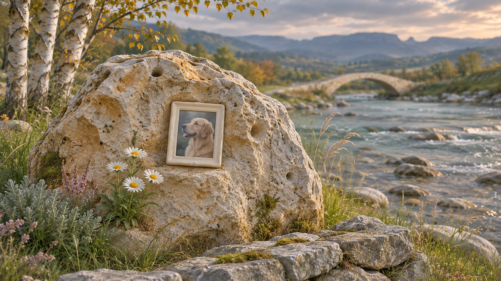
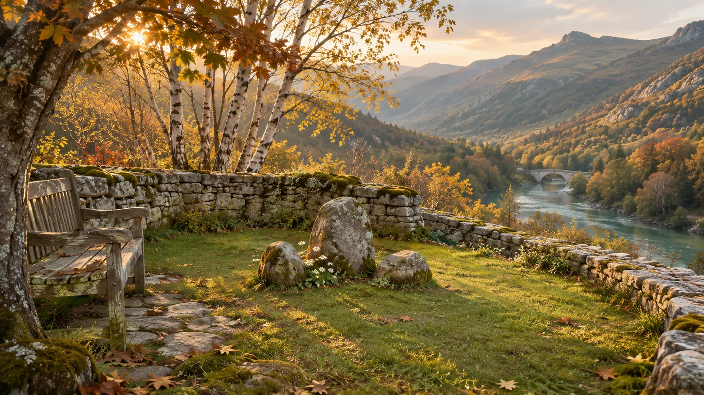

# 河湾 · 风景样板

栖光谷的第一段步行路线从西南桦坡出发，沿南岸经过一块纪念石，再过桥走到东北低脊的许愿树下。三幅概念图共用初秋傍晚的光色、单拱石桥、白桦和浅色石灰岩，可按步行顺序查看。

## A　入口望树

站在入口先找树冠，再找过河的桥。前景几块纪念石有真实石块的高低与间距，主路从它们身侧经过。搭地形时需保留草坡与河面的约 7 米高差，让初访者能一眼看清路线。

## B　石前看水

走近后，照片成为画面里最清楚的东西。相框下面留出能放一小束花的石沿，河声和水面留在身后。此图作为材质与比例的参考，先调好石头、相框和一朵免费花之间的大小关系，再加周围草木。手机竖屏应重新取景，使照片、花束和一小段河面同时可见。

## C　树下回望

视线从近处布带移到桥面，最后停在对岸的桦树。这是来路的反向视角，树下可以安静停留。后续制作时让风先动枝梢，再带起布带的末端，保留无遮挡的回望视线。

## D　听风山庭

从许愿树沿东侧支路进入庭院。步道穿过矮墙开口，长椅留给家人并坐或停留。家庭纪念石共享一个看山的朝向，每张照片仍按园主设置决定谁能看到。

## 搭建交接

总图记录可走路线、地标、河流走向与现行机位。三幅最初的 AI 概念图用于选材、构图和明暗参考，画中犬只为虚构示例。独立生成的画面在距离、日照与桥的位置上有偏差。旧版 B 机位朝西北看上游，桥落在画框外。

实时漫游的 B 机位从石的西南侧朝北偏东看，前景能看清照片，右后方是可步行通过的那座拱桥。原始设定图和早期离线档案仍保存河湾固定风景。设定图强调的是选址氛围，实时画质按可复拍的浏览器截图验收。

## 本轮实时场景的素材与取景

岩石、树皮、白桦叶簇、草穗、云层和林缘使用为本项目制作的纹理。近景的相框、岩体、浅滩、单拱桥和许愿树有实际空间位置；远山和林坡用两个不同距离的环形景片产生视差。球幕和水面共享云形、天色及时钟。低角度阳光投到凹凸石面、树影和草径，阴影深度图在光向、季节或树叶素材变化时更新。机位对照使用浏览器绘制的实际画面。

自动画质在连续移动时调节内部渲染尺寸和植被量，停步后恢复照片与近景精度。「精细」保持高清，「轻量」降低内部画幅，三种模式使用同一座花园。
